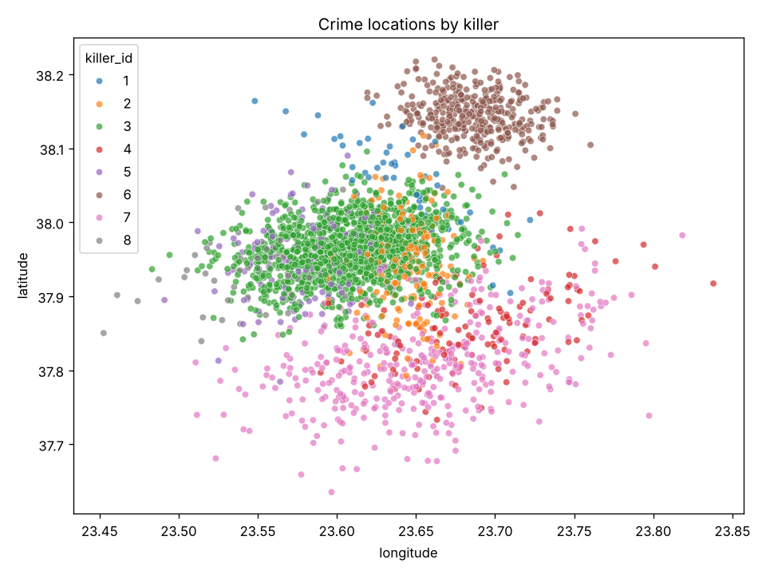
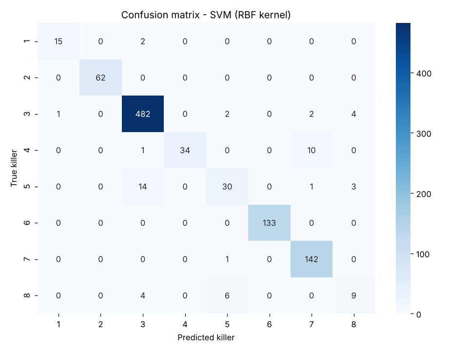
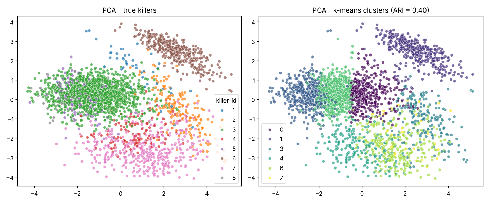

# Who Is The Killer?

Identifying which of 8 serial killers committed each crime, using classical pattern recognition and machine learning with scikit-learn.

*Course project for Pattern Recognition, Department of Informatics, University of Piraeus (2025–26).*



## The problem

The "Piraeus Vice" dataset has 4,800 crimes. Each crime has the time, place, victim, weather, weapon and scene type, plus the killer (1–8). The task is to learn from known cases and name the most likely killer for new ones.

| Split | Crimes | Use |
|---|---|---|
| TRAIN | 2,636 | fit the models |
| VAL | 958 | compare the models |
| TEST | 1,206 | held out, used once at the end |

**Features:** 8 continuous (`hour_float`, `latitude`, `longitude`, `victim_age`, `temp_c`, `humidity`, `dist_precinct_km`, `pop_density`) and 4 categorical (`weapon_code`, `scene_type`, `weather`, `vic_gender`).

## Approach

1. **Exploratory analysis:** class balance, crime locations, feature distributions.
2. **Gaussian MLE per killer:** mean and covariance of the continuous features for each class.
3. **Generative vs discriminative models:** Gaussian Naive Bayes, compared with Logistic Regression, an MLP (100 → 50 neurons) and an SVM with an RBF kernel. Continuous features are standardised and categorical ones one-hot encoded, inside scikit-learn pipelines.
4. **Class imbalance:** the same SVM with balanced class weights, so that mistakes on rare killers cost more.
5. **Unsupervised view:** PCA for visualisation, then k-means with k = 8, to see whether the killers form natural clusters without using the labels.
6. **Final evaluation:** the best model is retrained on TRAIN + VAL and scored once on TEST.

## Results

Validation set (958 crimes):

| Model | Accuracy | Balanced accuracy | Macro F1 |
|---|---|---|---|
| Gaussian Naive Bayes (continuous features only) | 0.833 | 0.768 | 0.707 |
| Logistic Regression | 0.943 | 0.834 | 0.856 |
| MLP (100, 50) | 0.936 | 0.821 | 0.836 |
| **SVM (RBF kernel)** | **0.947** | 0.839 | **0.862** |
| SVM (RBF, balanced weights) | 0.928 | **0.886** | 0.854 |

The discriminative models clearly beat Naive Bayes. The plain SVM has the best accuracy and macro F1, so it is the final model.

**On the held-out TEST set** (1,206 crimes), the SVM retrained on TRAIN + VAL reaches **95.6% accuracy** and **0.90 macro F1**.

### A closer look: accuracy hides the small classes

Killer 3 committed about half of all crimes, so a model can score high accuracy by doing well on killer 3 alone. Per-class recall on the validation set tells a more honest story:

| Killer | Crimes in VAL | SVM | SVM, balanced weights |
|---|---|---|---|
| 1 | 17 | 0.88 | 0.88 |
| 2 | 62 | 1.00 | 0.98 |
| 3 | 491 | 0.98 | 0.92 |
| 4 | 45 | **0.76** | **0.87** |
| 5 | 48 | **0.63** | **0.73** |
| 6 | 133 | 1.00 | 0.99 |
| 7 | 143 | 0.99 | 0.97 |
| 8 | 19 | **0.47** | **0.74** |

- Killer 5 is often mistaken for killer 3, and killer 8 for killers 3 and 5.
- Killer 4 is confused with killer 7, the neighbouring group on the map.
- Balanced class weights find far more of killers 4, 5 and 8 (recall 0.47 → 0.74 for killer 8), at the cost of more mistakes on killer 3. Which model is "better" depends on what matters more: overall accuracy, or not missing the rare killers.



### How much does location explain?

An SVM that only sees latitude and longitude reaches 0.80 accuracy but only **0.43 macro F1**, and it never predicts killers 4, 5 or 8. Location separates the killers who work in their own area, such as killer 6, but the other features are what tell apart killers who share a neighbourhood.

### Unsupervised: do the killers form natural clusters?



k-means finds the isolated groups well, for example killer 6 at the top right. It also splits the large killer-3 group into several clusters and merges neighbouring killers in the south. The match with the true killers is moderate: **ARI = 0.40** and **NMI = 0.58**, where 1 would be a perfect match and 0 random. So the structure is only partly visible without labels.

More figures are in [`figures/`](figures/): class distribution, feature histograms, killer 3's covariance matrix and the PCA scree plot. All numbers are in [`figures/results.csv`](figures/results.csv).

## What I would try next

- Features built from location, such as the distance from each killer's centre, to help with the overlapping killers.
- A tree-based model (for example gradient boosting) as a comparison to the SVM.
- Cross-validation instead of a single validation split. A quick grid search over `C` and `gamma` did not beat the default SVM on the validation set.

## How to run

```bash
pip install -r requirements.txt
python who_is_the_killer.py data/crimes.csv
```

The script prints all the results above. It also saves the figures, `results.csv` and the TEST predictions (`submission.csv`) to `figures/`, or to another folder with `--out`.

**Data:** the dataset was provided by the course and is not included in this repository. See [`data/README.md`](data/README.md) for the expected format.

## Repository structure

```
who_is_the_killer.py   full pipeline: EDA, models, PCA/k-means, evaluation
requirements.txt       Python dependencies
figures/               generated plots and results.csv
data/                  put the CSV here (not tracked by git)
```

## Author

Odysseas Tamvakos, Department of Informatics, University of Piraeus

## License

The code is released under the [MIT License](LICENSE). The dataset belongs to the course and is not included.
